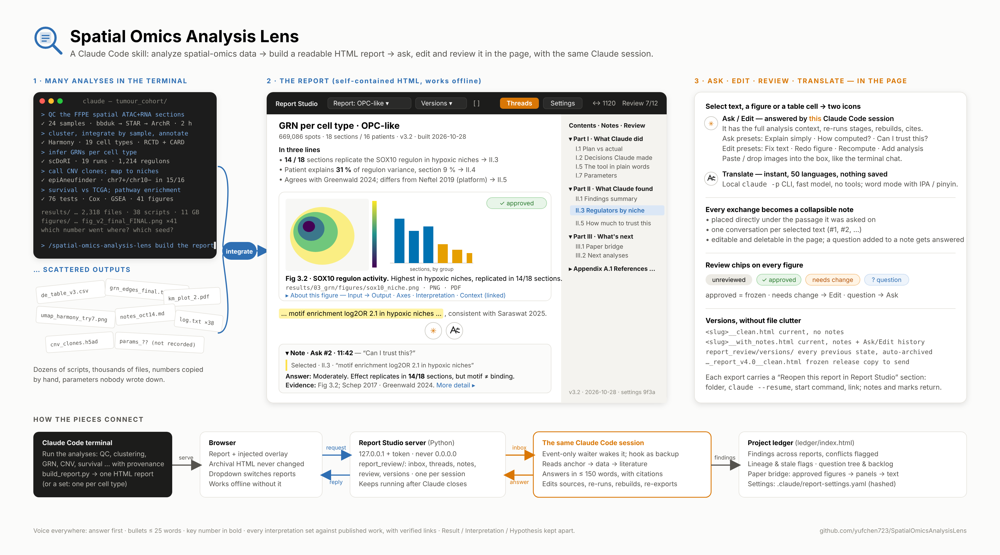

# Spatial Omics Analysis Lens

Turn a pile of spatial-omics and single-cell analyses into one report you can question. Run the downstream analyses in Claude Code with full provenance, build a self-contained HTML report, then select any sentence, figure or table cell in the page to **ask**, **edit**, **review** or **translate** it; the same Claude Code session answers, re-runs and rebuilds.



**Left:** many analyses in the terminal and the scattered outputs they leave behind. **Middle:** the report, served by Report Studio with its overlay (contents, threads, review progress, notes under the passage they were asked on). **Right:** what the two icons on a selection do, how notes and review chips work, and how versions are kept without file clutter.

## What you get

- **A report with three parts and an appendix.** *What Claude did* (plan vs actual, every decision with its alternative and a published precedent, lineage, the tool in plain words, every parameter with its default), *What Claude found* (findings table with literature context, themed result sections, how much to trust this), *What's next* (paper bridge with ready-to-paste Methods text, the top next analyses with precedents). Every figure has a one-line conclusion, its file path and a collapsible "About this figure".
- **Provenance you don't have to remember.** `plan.json` before any result, a run manifest per stage, `decisions.jsonl`, `lineage.json`, integrity checks at every join, and `report_data.json`: numbers are never typed by hand.
- **Ask / Edit in the page.** Select text, a figure or a table cell. **Ask** gets an answer in ≤ 150 words with this report's numbers and linked citations. **Edit** changes the source, re-runs the affected stages, rebuilds and re-exports. Paste or drop images into the box as in the terminal chat.
- **Review chips** on every figure: unreviewed · approved · needs change · question. Approved figures are frozen.
- **Translate**: instant, 50 languages, through the local `claude` CLI with no tools; nothing is saved.
- **Notes.** Every exchange becomes a collapsible note directly under the passage it was asked on, editable and deletable in the page.
- **Two current files, automatic history.** `<slug>__clean.html` and `<slug>__with_notes.html` are overwritten on every change; every previous state is archived; "release" writes a frozen `…_vX.Y__clean.html` to send. Every export carries a "Reopen this report in Report Studio" section (folder, `claude --resume`, start command, link).
- **Report sets** (one report per cell type or domain) with an overview page, and a **project ledger** that collects findings, flags conflicts and stale inputs, keeps the question tree and the paper figure plan.
- **Domain modules** for QC, clustering and integration, deconvolution, spatial domains, signature scoring, differential expression, chromatin and motifs, gene regulatory networks, cell–cell communication, CNV and clones, trajectories, clinical and survival, and platform or tool comparison. Each says what Input, Method, Result and Interpretation must contain and which pitfalls to check.

The voice is the same everywhere: answer first, bullets of ≤ 25 words with the key number in bold, every interpretation set against published work with verified links, Result / Interpretation / Hypothesis kept apart.

## First use

On the first report the skill asks up to five short questions (main question, disease or tissue, replicate unit, groups, languages) and writes `<project>/.claude/report-settings.yaml`. Everything project-specific lives in that file: entity colours, statistics policy, figure style, writing limits, the core references every report compares against. Edit it, say "set X to Y", or use the Settings panel in the page.

## Install

**Claude Code** (the live Ask / Edit loop needs Claude Code; this is where it runs):

```
/plugin install spatial-omics-analysis-lens --marketplace yufchen723/SpatialOmicsAnalysisLens
```

or, on older versions:

```
/plugin marketplace add yufchen723/SpatialOmicsAnalysisLens
/plugin install spatial-omics-analysis-lens@spatial-omics-analysis-lens
```

Then, in a project folder: `/spatial-omics-analysis-lens build a report of the GRN analysis` (or just describe the analysis; the skill loads by itself when an omics analysis should end in a report).

**Claude (web, desktop):** upload `skills/spatial-omics-analysis-lens/SKILL.md` as a skill (Customize → Skills → + → Upload). The report-writing rules work there too; Report Studio (Ask / Edit in the page) needs a local Claude Code session.

## Status

**Tested so far only in Claude Code in a Linux terminal** (the author's own analysis workstation, with reports opened in a browser on the same machine or through an `ssh -N -L` tunnel). macOS and Windows, the Claude desktop app's preview panel, and the Claude web app have not been tested; the report-writing rules should work anywhere, but Report Studio (the local server, Ask / Edit in the page, Translate through the `claude` CLI) is only verified on Linux. Issues and reports from other setups are welcome.

## What works where

| Feature | Claude Code in a terminal (tested on Linux) | Claude app (web, desktop; untested) |
| --- | --- | --- |
| Run analyses with provenance, build the report | ✓ | writing rules only |
| Report Studio: Ask / Edit / Review / Translate in the page | ✓ | — (static copy via Artifact) |
| Report sets, project ledger | ✓ | — |
| Offline `__clean` / `__with_notes` files | ✓ | — |

## Privacy and data

- **Everything runs on your machine.** Report Studio is a small Python server bound to `127.0.0.1` with a token; it never binds to `0.0.0.0`, never executes request content, and writes only into `report_review/`. Stop it when the review ends.
- **Inputs are read-only.** The skill writes only inside the analysis folder and asks before deleting, installing, or running anything expensive.
- **Ask / Edit** go to your own Claude Code session through a local inbox file; nothing leaves the machine except the model calls your session already makes.
- **Translate** calls the `claude` CLI already logged in on your machine (fast model, no tools, 60 s timeout, ≤ 4,000 characters) and saves nothing.
- **Reports never contain** patient identifiers, raw matrices or credentials; the provenance files exclude them by rule.
- **Literature lookups** use PubMed, bioRxiv and Google Scholar through Claude's web tools; the skill cites nothing it has not verified.
- No data is sent to the author of this plugin.

## Files

| Path | What it is |
| --- | --- |
| `skills/spatial-omics-analysis-lens/SKILL.md` | the skill: report structure, provenance rules, domain modules, Report Studio spec, ledger, settings template |
| `.claude-plugin/` | plugin and marketplace manifests |
| `docs/overview.png` | the overview figure above (`docs/overview.html` is its SVG source) |
| `CHANGELOG.md` | public version history |

## Credits

Built by [Yufan Chen](https://github.com/yufchen723) while doing spatial multi-omics for a PhD, together with Claude. Companion tools: [PaperLens](https://github.com/yufchen723/paperlens) (read a paper end to end) and [Agent Monitor](https://github.com/yufchen723/UsefulTools/tree/main/AgentMonitor).

## License

MIT
